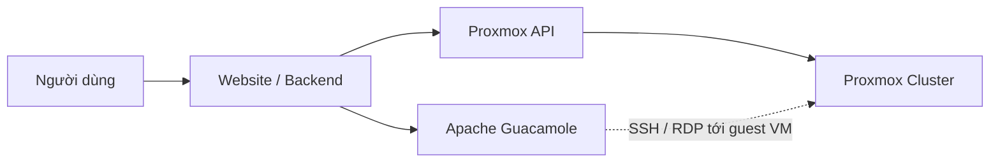
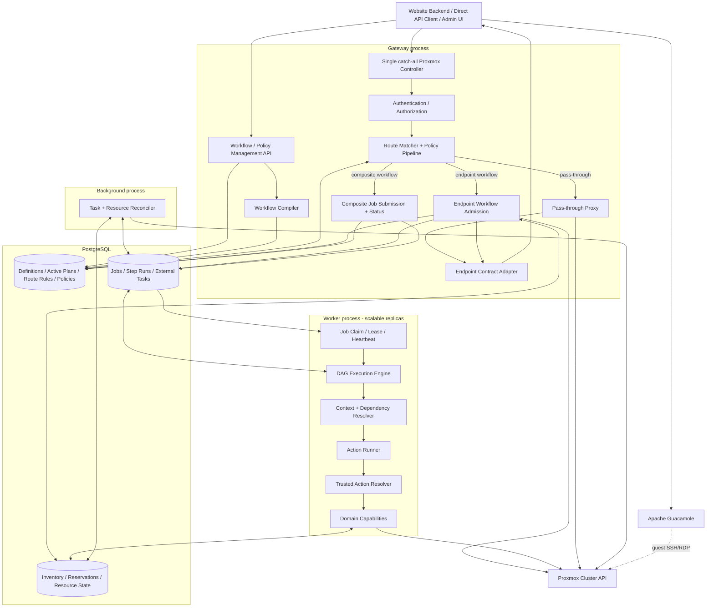
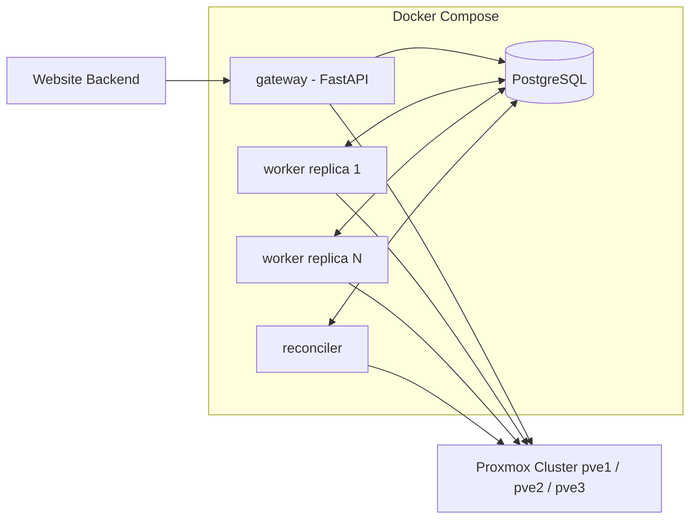
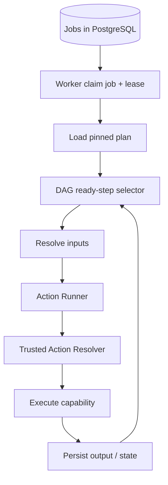
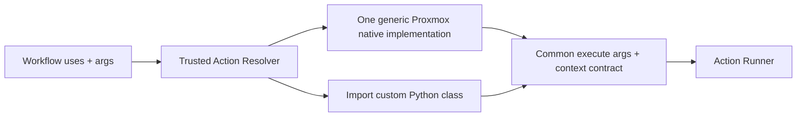
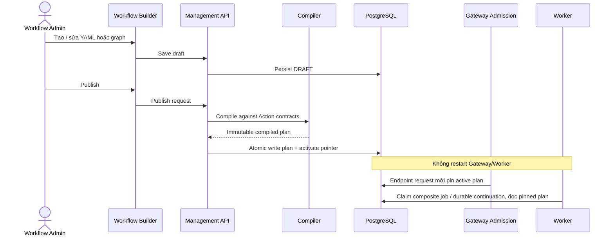
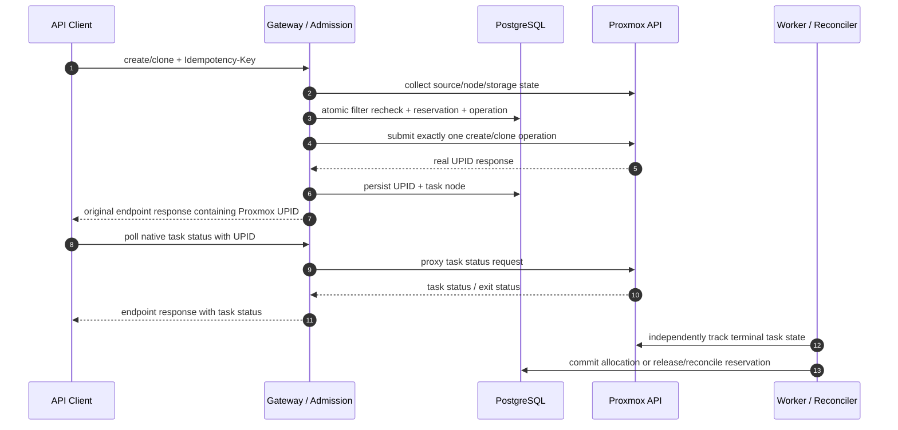
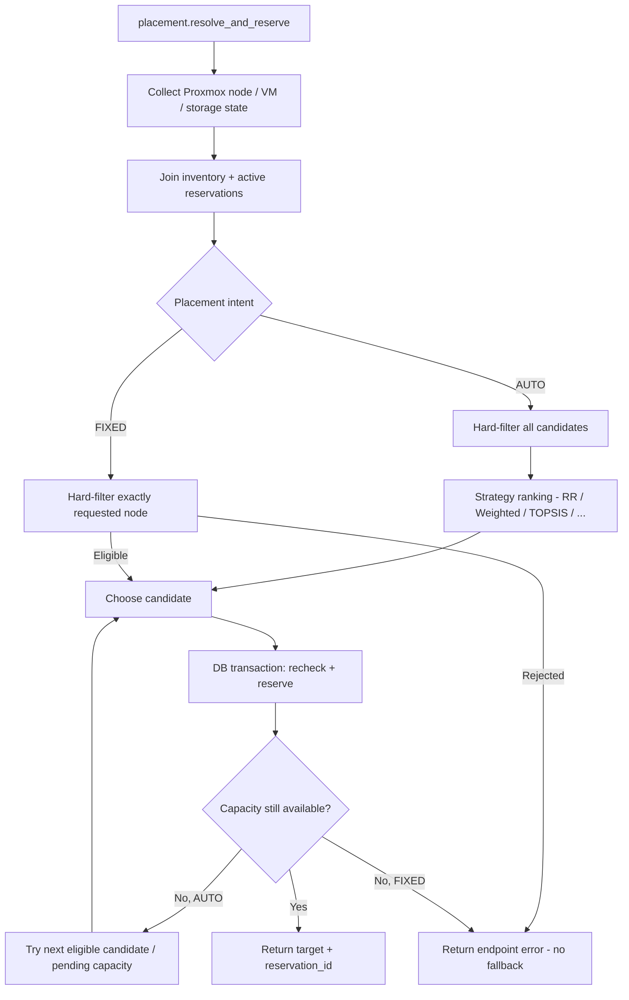

# Proxmox Gateway — Config-Driven Workflow Orchestration & Resource Scheduling

> **Trạng thái:** Tài liệu định hướng **kiến trúc production đích** (architecture baseline), dùng làm ngữ cảnh dài hạn của dự án. Các API, DSL, database schema và đoạn mã bên dưới là **thiết kế đề xuất**, chưa phải tính năng đã được hiện thực. Phạm vi thử nghiệm đầu tiên được đặc tả riêng tại [`docs/vertical-slice-0.md`](docs/vertical-slice-0.md).
>
> **Mục tiêu:** Xây dựng một lớp điều khiển mở rộng cho Proxmox VE, cho phép điều phối tài nguyên, tự động cấp phát một hoặc nhiều VM, và tùy biến hành vi API bằng workflow cấu hình động mà không phải chỉnh sửa Gateway cho từng nghiệp vụ.

## Mục lục

- [1. Bối cảnh và bài toán](#1-bối-cảnh-và-bài-toán)
- [2. Mục tiêu, phạm vi và nguyên tắc](#2-mục-tiêu-phạm-vi-và-nguyên-tắc)
- [3. Quyết định kiến trúc đã chốt](#3-quyết-định-kiến-trúc-đã-chốt)
- [4. Kiến trúc tổng thể](#4-kiến-trúc-tổng-thể)
- [5. Thành phần và trách nhiệm](#5-thành-phần-và-trách-nhiệm)
- [6. Vòng đời Action, Workflow và Policy](#6-vòng-đời-action-workflow-và-policy)
- [7. Luồng xử lý chính](#7-luồng-xử-lý-chính)
- [8. Workflow DSL và Action Contract](#8-workflow-dsl-và-action-contract)
- [9. Resource Scheduling và Multi-VM Lab](#9-resource-scheduling-và-multi-vm-lab)
- [10. Persistence, concurrency và recovery](#10-persistence-concurrency-và-recovery)
- [11. API và hợp đồng tích hợp](#11-api-và-hợp-đồng-tích-hợp)
- [12. Folder structure cuối cùng](#12-folder-structure-cuối-cùng)
- [13. Deployment, cấu hình và vận hành](#13-deployment-cấu-hình-và-vận-hành)
- [14. Bảo mật, observability và testing](#14-bảo-mật-observability-và-testing)
- [15. Lộ trình triển khai và tiêu chí nghiệm thu](#15-lộ-trình-triển-khai-và-tiêu-chí-nghiệm-thu)
- [16. Giới hạn và vấn đề cần quyết định khi hiện thực](#16-giới-hạn-và-vấn-đề-cần-quyết-định-khi-hiện-thực)
- [17. Tài liệu tham khảo](#17-tài-liệu-tham-khảo)

## 1. Bối cảnh và bài toán

### 1.1. Hệ thống hiện tại

Website cung cấp giao diện để người dùng khởi tạo, quản lý và sử dụng VM trực tiếp trên trình duyệt. Backend tương tác với **Proxmox VE API** để quản lý VM; **Apache Guacamole** tạo phiên SSH/RDP đến hệ điều hành khách khi VM đã sẵn sàng.



Một số Proxmox API tạo VM sử dụng đường dẫn chứa tên node, ví dụ `POST /api2/json/nodes/{node}/qemu`; clone sử dụng `POST /api2/json/nodes/{source_node}/qemu/{vmid}/clone`. Điều này khiến hệ thống hiện tại phải biết/chỉ định node, thường dẫn đến hardcode.

Gateway mở rộng đúng vị trí vốn biểu diễn **target placement** mà không đổi bản chất operation:

- Create: `/nodes/auto/qemu` yêu cầu Gateway tự chọn target; `/nodes/{real_node}/qemu` giữ target do người dùng chỉ định.
- Clone: source node vẫn nằm trong path; `target=auto` trong body yêu cầu Gateway chọn target, `target=<real_node>` là fixed placement, còn thiếu `target` giữ nguyên hành vi Proxmox là clone tại source node.
- Tất cả create/clone, dù `AUTO` hay `FIXED`, đều đi qua workflow tương ứng để filter, reserve, accounting và theo dõi task; đây không phải hai contract API khác nhau.

### 1.2. Những bài toán cần giải quyết

1. **Automatic placement:** Chọn node dựa trên CPU, RAM, storage, network, template và chính sách scheduling thay vì hardcode node.
2. **Resource accounting:** Ngăn nhiều yêu cầu đồng thời cấp phát vượt khả năng của cluster; quản lý reservation và allocations.
3. **VM lifecycle:** Clone/create, configure, start, theo dõi Proxmox task, guest readiness và xử lý lỗi.
4. **Multi-VM lab:** Triển khai nhiều VM theo topology, dependency, affinity/anti-affinity và chính sách xử lý thất bại một phần.
5. **Extensible API behavior:** Có thể can thiệp vào nhiều endpoint Proxmox, không chỉ provisioning.
6. **Runtime customization:** Người quản trị tạo/sửa/publish workflow và placement policy khi ứng dụng đang chạy.
7. **Maintainability:** Logic tái sử dụng, định dạng workflow chuẩn hóa và hạn chế sửa core khi phát triển tính năng mới.

> 💡 **Giới hạn bản chất:** Cluster Proxmox không gộp CPU/RAM các node thành một host vật lý duy nhất. Mỗi VM chạy trên một node tại một thời điểm; scheduler chịu trách nhiệm placement và quản lý tài nguyên cấp cluster.

## 2. Mục tiêu, phạm vi và nguyên tắc

### 2.1. Mục tiêu sản phẩm

- Giữ **một catch-all controller** cho bề mặt Proxmox-compatible API; website không phải biết chi tiết routing nội bộ của proxy.
- Hỗ trợ **pass-through**, **policy interception** và **workflow override** bằng cấu hình route.
- Giữ **request compatibility** và **behavioral compatibility** theo từng endpoint: method, path, body và ý nghĩa operation của Proxmox không bị thay đổi ngoài những extension được công bố rõ như `auto`.
- Mỗi endpoint có một response contract ổn định; cùng một endpoint không đổi format chỉ vì Gateway chọn pass-through hay workflow ở bên trong.
- Cho phép workflow dạng **declarative DAG** được định nghĩa/publish qua Management API/UI.
- Chuẩn hóa Action Contract và tái sử dụng capability qua nhiều workflow.
- Cho phép chỉnh chiến lược/constraints/trọng số scheduler bằng Policy Editor nếu DSL đã hỗ trợ.
- Xử lý job bất đồng bộ, ghi trạng thái bền vững, hỗ trợ retry có kiểm soát và reconciliation.
- Triển khai on-premise bằng Python, PostgreSQL, Docker Compose; mở rộng Worker replicas khi cần.

### 2.2. Ngoài phạm vi ban đầu

- Không xây môi trường thực thi Python tùy ý từ mã do người dùng nhập trên UI.
- Không xây **Action Builder**; Action Catalog trên UI là **read-only**.
- Không bắt buộc RabbitMQ/Redis/Outbox trong phiên bản kiến trúc đầu tiên.
- Không cam kết mọi Gateway-specific orchestration endpoint có wire contract giống Proxmox; endpoint nhiều bước có thể công bố `202 + job_id` riêng.
- Không xây microservice riêng cho Compiler, Registry, DAG Engine, Scheduler hoặc từng Action.
- Không tạo hệ thống live migration/HA mới thay thế cơ chế Proxmox hiện hữu.

### 2.3. Nguyên tắc thiết kế

- **Workflow = What to do:** định nghĩa trình tự, dependencies, branching, output, failure behavior.
- **Policy/Strategy = How to decide:** quy định ràng buộc và cách đánh giá/lựa chọn, ví dụ node placement.
- **Action/Capability = What the platform can do:** thực thi năng lực đã được cài đặt, có schema và quyền rõ ràng.
- **Gateway routes once:** Controller/Route Matcher quyết định proxy hoặc workflow; Worker không phân loại lại HTTP request.
- **Endpoint owns the contract:** route quyết định contract trước khi thực thi; pass-through và workflow của cùng endpoint phải đi qua cùng response/error adapter.
- **Preserve operation boundaries:** endpoint create chỉ create, endpoint clone chỉ clone. Configure, start hoặc guest readiness là operation/workflow khác, không âm thầm ghép vào create/clone.
- **Placement respects intent:** `AUTO` được phép chọn node; `FIXED` chỉ kiểm tra và giữ đúng node người dùng yêu cầu, không tự fallback.
- **Gateway owns the response boundary:** workflow gắn với endpoint có thể chạy admission prefix trong Gateway đến khi nhận và persist UPID; Worker/Reconciler tiếp tục theo dõi task sau khi HTTP response đã trả.
- **Worker executes; Engine orchestrates:** workflow bất đồng bộ và durable continuation chạy qua DAG Engine bên trong Worker process, không phải service Engine riêng.
- **Database is source of truth:** PostgreSQL lưu workflow đã publish, plan, job, step, reservation, inventory.
- **No mandatory semantic versioning:** Không bắt buộc `workflow@1.0.0` hoặc `action@1`. Vẫn giữ execution plan snapshot bất biến cho mỗi job.
- **Safe by default:** Không cho workflow tùy ý thực thi lệnh, gọi URL bất kỳ hoặc vượt quyền của tenant.

## 3. Quyết định kiến trúc đã chốt

| Chủ đề | Quyết định | Lý do |
|:--|:--|:--|
| Core | **Modular monolith / shared codebase** | Phân định trách nhiệm bằng module, tránh phân tán quá sớm |
| Runtime | `gateway`, `worker`, `reconciler` (có thể chạy riêng) | Scale theo tải nhưng dùng chung contracts |
| Queue | **PostgreSQL-backed job queue** | Tránh thêm RabbitMQ và Outbox khi chưa cần |
| HTTP | **Một catch-all Proxmox controller** + Management API | Không phải mirror từng Proxmox endpoint |
| API compatibility | **Giữ method/path/body và operation semantics theo endpoint** | Có thể mở rộng sentinel như `auto` nhưng không đổi nghĩa request hợp lệ hiện hữu |
| Provision mutation | **Create/clone luôn qua workflow tương ứng** | Kể cả fixed node vẫn cần filter, reservation, accounting và task tracking |
| Placement intent | **`AUTO` chọn node; `FIXED` giữ node được chỉ định** | Fixed placement không scoring và không fallback sang node khác |
| Endpoint response | **Create/clone trả response chứa UPID thật của Proxmox** | HTTP response xác nhận task được Proxmox chấp nhận; client theo dõi task qua UPID |
| Error boundary | **Public error theo ngữ nghĩa endpoint; provenance chỉ lưu nội bộ** | Client nhìn thấy một hệ thống, vận hành vẫn phân biệt nguồn lỗi để chẩn đoán/recovery |
| Workflow | **YAML/JSON DSL, runtime publish vào PostgreSQL** | Tạo workflow mà không restart worker |
| Workflow store | **PostgreSQL** | Lưu definition, compiled plan, trạng thái active |
| Action Resolver | **Native descriptor + trusted custom class import** | Chung Action Contract, không đăng ký từng endpoint Proxmox |
| Action discovery | **Startup qua trusted Python packages** | Có thể bổ sung capability mà không sửa core framework |
| Action Catalog UI | **Chỉ đọc metadata / schema** | Không mở thực thi code tùy ý cho người dùng |
| Scheduling | **Capability `placement`** với Policy/Strategy | Không hardcode scheduler trong Engine hoặc Workflow |
| Policy | **Cấu hình động, validate/publish qua DB** | Chỉnh constraints/weights không deploy code |
| Engine | **Durable DAG executor bên trong Worker** | Quản lý state, dependencies và recovery |
| Execution snapshot | **Compiled plan được pin vào Job** | Job cũ không đổi cấu trúc khi workflow được cập nhật |
| Idempotency | **Bắt buộc với provision mutation ở production** | Cùng key/cùng request trả lại operation cũ; cùng key/body khác bị từ chối |
| Identity | **Client xác thực với Gateway; Gateway dùng service credential gọi Proxmox** | Không chuyển tiếp credential Proxmox của client |
| Guacamole | **Website backend quản lý session** | Gateway chỉ cấp VM và thông tin readiness |

> ⚠️ **Về thay đổi Action code:** Plan snapshot chỉ giữ cấu trúc workflow và dữ liệu cấu hình, **không đóng băng Python implementation**. Khi đổi implementation không tương thích, cần drain job hoặc triển khai theo chính sách tương thích; nếu cần bảo đảm chạy logic cũ tuyệt đối thì phải giữ runtime/image cũ cho các job đang chạy.

## 4. Kiến trúc tổng thể

### 4.1. Sơ đồ logical architecture



**Lưu ý sơ đồ:** `Endpoint Workflow Admission` chạy phần response-critical của create/clone trong request lifecycle: normalize, filter, reserve, submit Proxmox task và persist UPID. HTTP response được trả ngay khi đạt response milestone của endpoint; Worker/Reconciler tiếp tục theo dõi terminal status và commit/release reservation. Đường Guacamole → Proxmox Cluster tượng trưng cho tuyến mạng tới *guest VM*, không phải Guacamole SSH/RDP vào hypervisor. Management API có thể nằm trong cùng FastAPI application nhưng là nhóm route quản trị khác với catch-all Proxmox API.

### 4.2. Sơ đồ physical deployment



Khởi đầu có thể chạy **1 Gateway + 1 Worker + PostgreSQL**; Reconciler có thể chạy trong cùng container Worker ở giai đoạn thử nghiệm, rồi tách process khi cần. Mỗi Worker có thể giao tiếp với *mọi node được phép* trong cluster.

## 5. Thành phần và trách nhiệm

### 5.1. Gateway

| Module | Nhiệm vụ |
|:--|:--|
| `controller` | Nhận mọi HTTP method trên `/api2/json/{path:path}` |
| `request_context` | Chuẩn hóa request, identity, tenant, correlation ID |
| `authorization` | Phân quyền trên VM, lab, cluster và action |
| `route_matcher` | Tra cứu route rules đang active, áp dụng precedence rõ ràng |
| `policy_pipeline` | Quota, audit, request/response modification theo policy |
| `proxy_executor` | Chuyển tiếp API được cho phép tới Proxmox |
| `operation_service` | Validate input/idempotency, pin plan, persist internal operation và điều phối response milestone |
| `response_adapter` | Giữ contract theo endpoint; map public error theo ngữ nghĩa mà không lộ component origin |
| `job_service` | Submit và truy vấn composite workflow có public job contract |
| `management` | Tạo draft, validate, publish, deactivate workflow/policy/route |

**Bảo đảm:** Không bắt Controller biết `create`, `clone`, `migrate`, `snapshot` ở mức business logic. Route binding đưa toàn bộ endpoint create/clone vào workflow tương ứng, không phân nhánh pass-through chỉ vì path chứa node thật. Auto/fixed placement được normalize bên trong capability, còn Controller vẫn generic.

### 5.2. Compiler và Workflow Store

- **Parser/Schema Validator:** YAML/JSON → typed workflow definition.
- **Action Contract Resolver:** kiểm tra Action được cài đặt và schema input/output tương ứng.
- **DAG Validator:** kiểm tra `needs`, cycle, tham chiếu output, điều kiện và bước unreachable.
- **Safety Validator:** kiểm tra action allowlist, quyền, side effects và retry/recovery policy.
- **Plan Builder:** tạo *compiled execution plan* với dependencies, bindings và metadata có thể serialize.
- **Workflow Store:** PostgreSQL lưu draft, plan immutable, active pointer; không phải microservice Registry riêng.

Không compile tùy ý khi Worker nhận mỗi job. **Compile lúc publish**; Worker tải compiled plan gắn với job và validate contract/runtime tương ứng.

### 5.3. Worker và DAG Engine

- **Worker** là process chạy vòng lặp claim job, gia hạn lease, giới hạn concurrency, quản lý shutdown/health.
- **DAG Engine** là Python object/module bên trong Worker, lựa chọn step đủ dependencies, binding input, gọi Action Runner và persist step state.
- **Action Runner** resolve `uses` qua trusted Action Resolver và thực thi đúng Action Contract.
- **Checkpoint/Recovery** lưu bước đã thành công, trạng thái tác vụ ngoài, retry schedule và lỗi.
- **External Task Tracking** tiếp tục theo dõi Proxmox UPID sau khi HTTP response đã trả; tác vụ lâu có thể chuyển sang `WAITING` để nhường slot.



### 5.4. Action Resolver và Catalog

Mọi Action có chung contract `execute(args, context) -> ActionResult`. Resolver chỉ quyết định implementation; Engine gọi cùng một entry point cho native và adhoc.

- `proxmox.native.nodes(${...}).qemu(${...}).clone.post`: parse resource chain thành descriptor cho một `ProxmoxNativeAction` tổng quát. Không tạo class/file cho từng API endpoint.
- `adhoc.clone.PrepareClone`: import class `PrepareClone` từ trusted namespace `app.actions.clone`, kiểm tra Action Contract rồi tạo instance.
- Không bắt buộc decorator, registration function hoặc mapping đăng ký từng Action. Có thể cache implementation/compiled descriptor trong process.
- Compiler/loader kiểm tra action availability, references và namespace trước execution; người dùng không nhập Python code qua UI.
- Action nhận dependencies qua context/constructor. Proxmox adapter dùng chung giữ HTTP, service token, TLS, timeout; adapter không phụ thuộc FastAPI.
- Workflow/Action trả kết quả dữ liệu. HTTP response/error mapping nằm ở Gateway response boundary.

Production vẫn có thể cung cấp read-only Action Catalog để hiển thị metadata/schema/permissions của các implementation được phép. Catalog không yêu cầu mirror mọi endpoint Proxmox thành Python classes hay một registry server riêng.

### 5.5. Domain Capabilities

| Capability | Những năng lực chính |
|:--|:--|
| `placement` | Thu thập resources, filtering, scoring, strategy selection, atomic reservation |
| `resources` | Capacity, committed allocations, reservations, VM inventory reconciliation |
| `proxmox` | Các Proxmox operations được allowlist, VM clone/create/start/migrate, task state |
| `network` | IP allocation, VNet/bridge requirements, conflict prevention |
| `guest` | SSH/RDP readiness, guest-agent/connection checks theo capability |
| `lab` | Group placement, topology, anti-affinity, aggregate inventory/lifecycle |

**Ranh giới:** Framework không biết `scheduler`, `VMID`, `IP` hay `NFS`. Nó chỉ gọi Action có contract. Bên trong `placement`, các strategy là plugin nội bộ, không phải Action riêng cho từng thuật toán.

## 6. Vòng đời Action, Workflow và Policy

### 6.1. Action: từ source code tới implementation



Thêm native endpoint chỉ thay resource chain và arguments trong workflow; developer không phải thêm file Action. Thêm nghiệp vụ custom cần implementation trong trusted package rồi deploy code. Production publish validation phải kiểm tra implementation và permissions được hỗ trợ trên runtime sẽ chạy plan.

### 6.2. Workflow: người dùng publish ngay khi runtime



**Workflow Store PostgreSQL** là nguồn sự thật; không cần đồng bộ một dictionary workflow tới mọi process. Endpoint admission pin active plan khi nhận request mới; Worker tải plan đã pin khi claim composite job hoặc durable continuation. Workflow đã publish chỉ được activate nếu Gateway/Worker deployment liên quan hỗ trợ đủ Action được tham chiếu.

### 6.3. Policy: runtime editing, validation và snapshot

- Người quản trị tạo/sửa policy qua Policy Editor; cấu hình có schema hạn chế (constraints, metric, weights, strategy đã hỗ trợ).
- Publish chỉ thành công sau validation và kiểm tra capability cần thiết.
- Job mới sử dụng **snapshot policy** đã resolve hoặc policy data được nhúng trong compiled job context để job cũ không bị thay đổi kết quả do sửa config.
- Nếu muốn thuật toán mới mà DSL không biểu diễn được, viết **Strategy Plugin** trong `placement`; không cần Action mới nếu contract `placement.reserve` giữ nguyên.

### 6.4. Không bắt buộc semantic versioning

Mỗi workflow có một **active plan pointer**. Khi publish thay đổi, hệ thống tạo một plan immutable mới và đổi pointer; job hiện hữu tiếp tục tham chiếu plan cũ. Có thể dùng `plan_id` và `content_hash` **như định danh kỹ thuật**, không phải người dùng phải quản lý `v1/v2`.

> ⚠️ **Quan trọng:** Nội dung compiled plan phải persist sau khi publish; nếu chỉ lưu trong RAM thì Worker restart không thể resume những job đang sử dụng kế hoạch cũ. Action implementation thay đổi không tương thích vẫn cần chính sách deploy bảo toàn hành vi.

## 7. Luồng xử lý chính

### 7.1. Pass-through API

1. Website backend hoặc direct API client gọi một endpoint thuộc `/api2/json/{path:path}`.
2. Gateway xác thực identity/tenant, match route, thực hiện policy bắt buộc.
3. Nếu route cho phép pass-through, Gateway forward request tới Proxmox với quyền phù hợp.
4. Response trả về client theo endpoint contract; audit log ghi lại correlation ID.

> ⚠️ **Không được pass-through mù quáng:** Các lệnh thay đổi VM/node/storage có thể ảnh hưởng resource accounting. Cần route allowlist, authorization, audit và reconciliation hoặc workflow override. Hạn chế proxy tới endpoint nguy hiểm bằng token đặc quyền.

### 7.2. Create VM qua endpoint workflow

Cả `POST /api2/json/nodes/auto/qemu` và `POST /api2/json/nodes/{real_node}/qemu` đều đi qua cùng workflow create. Khác biệt chỉ nằm ở placement intent:

- `node=auto` → `AUTO`: filter toàn bộ candidate, chạy strategy và reserve node được chọn.
- `node=<real_node>` → `FIXED`: filter đúng node đó, reserve nếu hợp lệ; nếu không hợp lệ thì trả lỗi và **không fallback**.

Workflow chỉ thực hiện đúng operation create. Nó không tự configure, start hoặc chờ guest readiness. Gateway giữ nguyên body Proxmox, chỉ thay sentinel `auto` trong upstream path bằng target node đã chọn.

### 7.3. Clone VM qua endpoint workflow

Endpoint giữ nguyên source semantics của Proxmox:

```text
POST /api2/json/nodes/{source_node}/qemu/{vmid}/clone
```

| Giá trị `target` trong body | Placement intent | Hành vi |
|:--|:--|:--|
| Không có `target` | `FIXED(source_node)` | Giữ nguyên native behavior; không tự chèn `target` |
| `target=<real_node>` | `FIXED(real_node)` | Filter và dùng đúng node được chỉ định |
| `target=auto` | `AUTO` | Gateway chọn node rồi chỉ thay `auto` bằng node thật trước khi gọi Proxmox |

Gateway không dùng `/nodes/auto/.../clone` để thay source node và không tự tìm source trong contract này. Create và clone là hai workflow riêng, cùng tái sử dụng placement/reservation/task-tracking capabilities.

### 7.4. Response milestone và terminal state



HTTP success chỉ có nghĩa Proxmox đã chấp nhận task và trả UPID. VM chỉ được coi là tạo thành công khi task đạt terminal success và VM thực tế tồn tại. Internal operation/job tiếp tục sống sau HTTP response nhưng `job_id` không phải public contract bắt buộc của create/clone.

### 7.5. Composite provisioning và lab nhiều VM

Configure, cloud-init, start, guest readiness hoặc một lab nhiều VM thuộc **composite orchestration**, không thuộc create/clone endpoint workflow. Gateway-specific endpoint cho loại nghiệp vụ này có thể trả `202 Accepted + job_id` vì một job có thể chứa nhiều Proxmox task/UPID.

1. Website gửi `LabSpec` gồm danh sách VM, topology, dependencies và placement constraints.
2. Worker dùng **group planning/reservation** để kiểm tra năng lực của toàn bộ lab trước khi tạo VM đầu tiên.
3. Engine triển khai những VM độc lập song song với concurrency limit.
4. Các VM phụ thuộc sẽ chỉ chạy khi prerequisite đã hoàn thành; readiness theo từng VM.
5. Nếu một VM thất bại, áp dụng **partial-failure policy** (`retain`/`cleanup` theo cấu hình), reconcile những VM đã được tạo.
6. Group inventory phản ánh trạng thái lab và VM con; không giả định Proxmox cung cấp một distributed transaction cho toàn bộ lab.

### 7.6. Override hành vi endpoint khác

Ví dụ migrate VM:

- Route matcher chọn workflow `vm.migrate` thay vì proxy trực tiếp.
- Workflow dùng lại `placement.reserve` với *migration constraints* riêng.
- Gọi Proxmox migrate API và theo dõi UPID.
- Reconcile allocation của **source + target node** khi migration hoàn tất.

Clone, create, migrate, snapshot hoặc delete có thể chia sẻ Action theo contract, nhưng không ép các nghiệp vụ có operation semantics khác nhau vào cùng một workflow cứng.

## 8. Workflow DSL và Action Contract

### 8.1. Ví dụ endpoint workflow cho clone

Bản tuần tự hiện tại nằm ở [workflow_clone_vm.yaml](src/app/config/workflows/workflow_clone_vm.yaml):

```yaml
name: vm.clone

steps:
  - id: prepare
    uses: adhoc.clone.PrepareClone
    args:
      request: "${request}"

  - id: clone
    uses: "proxmox.native.nodes(${steps.prepare.output.source_node}).qemu(${steps.prepare.output.source_vmid}).clone.post"
    args: "${steps.prepare.output.clone_params}"

  - id: record
    uses: adhoc.operations.RecordSubmission
    args:
      operation_id: "${steps.prepare.output.operation_id}"
      upstream_response: "${steps.clone.output}"

response:
  from: "${steps.clone.output}"
```

`sync` mô tả admission/submit trong HTTP request; task Proxmox vẫn bất đồng bộ. Response chỉ trả sau khi step `record` đã persist UPID, nhưng status/headers/body lấy từ native clone response. Background tracker xử lý terminal status/accounting. Không configure, start hay chờ guest readiness.

Production có thể bổ sung `needs`, branching, response milestone và durable continuation trong cùng kiến trúc Action/Plan; Slice 0 hiện chỉ chạy tuần tự, không claim đã có durable DAG runtime. Management publish, plan snapshots và recovery vẫn là mục tiêu production trong các phần sau.

### 8.2. Action Contract

Action công bố tối thiểu:

| Thuộc tính | Mục đích |
|:--|:--|
| `name` | Tên duy nhất, ví dụ `placement.reserve` |
| `input_schema` | Schema/kiểu đầu vào để compiler và runtime validate |
| `output_schema` | Schema dữ liệu mà downstream step được tham chiếu |
| `required_permissions` | Phạm vi quyền để được invoke |
| `side_effect` | Action có thay đổi trạng thái bên ngoài hay không |
| `retry_policy` | Khi nào được retry an toàn |
| `reconcile` | Cách xác định kết quả của operation chưa rõ trạng thái |
| `execute(args, context)` | Entry point duy nhất Engine gọi |

```python
from abc import ABC, abstractmethod
from app.framework.contracts.action import ActionResult

class BaseAction(ABC):
    name: str
    input_schema: type
    output_schema: type

    @abstractmethod
    async def execute(self, args: object, context) -> ActionResult:
        ...
```

**Quy tắc granularity:** `placement.reserve` là một action atomic theo nghiệp vụ; không tách tùy tiện thành những Action độc lập `read_capacity` → `check_capacity` → `write_reservation` gây race condition.

### 8.3. Placement Policy Definition

```yaml
name: balanced
strategy: weighted
constraints:
  - metric: node.online
    op: eq
    value: true
  - metric: node.allocatable_memory_mb
    op: gte
    value: "${input.resources.memory_mb}"
scoring:
  direction: maximize
  metrics:
    - name: cpu_headroom_ratio
      weight: 0.4
    - name: memory_headroom_ratio
      weight: 0.6
```

Người quản trị có thể thay weights, constraints và chọn chiến lược đã được hệ thống hỗ trợ mà không thay đổi Action hoặc deploy code. Policy engine phải giới hạn các operator/metric được hỗ trợ; không `eval()` biểu thức Python từ database.

## 9. Resource Scheduling và Multi-VM Lab

### 9.1. Placement Pipeline



Create lấy intent từ `{node}` trong path (`auto` hoặc node thật). Clone giữ source node trong path và lấy intent từ body: thiếu `target` là `FIXED(source_node)`, node thật là `FIXED(node)`, `target=auto` là `AUTO`. Fixed placement không chạy scoring và không bao giờ âm thầm đổi node.

### 9.2. Resource accounting

- CPU: phân biệt vCPU đã cấp phát và capacity/overcommit policy; không chỉ đọc % CPU usage tức thời.
- RAM: xét committed memory, host reserve, active reservation và overcommit policy; không chỉ đọc `free` hiện tại.
- Storage: kiểm tra datastore có truy cập được từ target node; **shared NAS được tính một lần** theo datastore, không nhân lên theo số node.
- Network: kiểm tra VNet, MTU, IP/subnet, route đến guest từ Guacamole và vùng cấp phát IP.
- Template: phân biệt **source node** của template và **target node** của VM; kiểm tra điều kiện clone cross-node/storage.
- Placement: affinity/anti-affinity, maintenance/drain node, quota theo tenant/lab.

### 9.3. Reservation và đồng thời

- Trước khi ghi reservation phải khóa tài nguyên accounting liên quan trong PostgreSQL transaction.
- Cùng một logical resource có một quy tắc khóa nhất quán để hạn chế deadlock.
- Commit transaction nhanh; **không giữ DB row lock trong lúc Proxmox clone VM**.
- Reservation có lifecycle `HELD` → `ALLOCATED` hoặc `RELEASED`/`RECONCILING`.
- Reconciliation đối chiếu tình trạng VM thật khi có HA/migration/restart nội bộ, break-glass administration, inventory drift hoặc external task mất kết quả. Gateway là mutation ingress chính nhưng Proxmox vẫn là source of truth cho trạng thái hạ tầng thực tế.

## 10. Persistence, concurrency và recovery

### 10.1. Nhóm bảng dự kiến

| Nhóm | Bảng | Dữ liệu chính |
|:--|:--|:--|
| Management | `workflows` | name, draft, active_plan_id, status, owner |
| Management | `workflow_plans` | immutable compiled JSON, hash, action contract manifest |
| Management | `route_rules` | method/path, execution type, workflow binding, policy chain |
| Management | `placement_policies` | cấu hình và trạng thái publish |
| Execution | `jobs` | internal durable operation: workflow/plan, request fingerprint, status, idempotency key, response milestone, lease |
| Execution | `step_runs` | step status, attempts, input/output, dependencies |
| Execution | `external_tasks` | UPID thật của Proxmox, task node, upstream response metadata, reconciliation state |
| Resource | `vm_inventory` | vmid, node, lab, owner, allocated resources |
| Resource | `resource_reservations` | job, node/datastore, amounts, state |
| Resource | `node_capacity` | capacity snapshot/allocatable limits |
| Audit | `audit_events` | actor, action, target, correlation ID, result |

`workflow_plans` sử dụng **plan_id/hash** để giữ immutable snapshot, **không ép người dùng quản lý semantic version**. Không xóa plan khi còn Job tham chiếu.

Đối với create/clone endpoint workflow, `jobs` là internal operation record nối request → reservation → selected node → VMID → UPID → terminal result. Client không bắt buộc nhận hoặc polling `job_id`; public response vẫn theo contract UPID của endpoint. Failure metadata nội bộ lưu `failure_origin`, upstream status/body đã sanitize, retry classification, public error code và correlation ID, nhưng không công bố component origin như một phần public error.

### 10.2. PostgreSQL work queue

Worker claim job bằng transaction ngắn, có thể sử dụng `FOR UPDATE SKIP LOCKED` để nhiều consumer tránh tranh chấp cùng một hàng. Sau claim, cập nhật `lease_owner`, `lease_until`, status và commit; job thực thi bên ngoài transaction.

```sql
-- Pseudocode SQL để minh họa lựa chọn job; không phải migration hoàn chỉnh.
BEGIN;

SELECT id
FROM jobs
WHERE status IN ('QUEUED', 'RETRY_PENDING')
  AND (next_run_at IS NULL OR next_run_at <= NOW())
ORDER BY created_at, id
FOR UPDATE SKIP LOCKED
LIMIT 1;

-- UPDATE claimed job: status, lease_owner, lease_until, attempt_count
COMMIT;
```

**Quan trọng:** Lease có thể hết hạn do Worker crash; chỉ một process được sở hữu *điều phối* tại một thời điểm, nhưng điều này **không tự bảo đảm external Proxmox side effect được thực hiện đúng một lần**. Cần idempotency + external task reconciliation.

### 10.3. Idempotency cho provision mutation

Ở production, mọi create/clone request phải có `Idempotency-Key`, kể cả khi client đã gửi `vmid`/`newid`:

- Cùng principal, endpoint, key và request fingerprint → trả lại cùng internal operation và cùng response/UPID đã lưu khi có.
- Cùng key nhưng fingerprint khác → từ chối conflict; không tái sử dụng key cho intent mới.
- Operation đang `SUBMITTING`, `SUBMITTED` hoặc `RECONCILING` không được POST lại mù quáng.
- Nếu mất kết nối sau khi submit, phải reconcile bằng VMID/UPID/trạng thái thật trước khi quyết định retry.

Yêu cầu header này là extension admission của Gateway; request compatibility ở đây cam kết giữ method/path/body và operation semantics, không tuyên bố drop-in wire compatibility 100% với mọi Proxmox client.

### 10.4. Retry, timeout và crash recovery

- Các action chỉ đọc thông tin có thể retry khi transient error.
- `clone/create/migrate/delete` là action có side effect: timeout/connection loss có thể là **unknown outcome**, phải kiểm tra VMID/UPID/operation reference trước khi POST lại.
- Persist UPID và task node; chờ Proxmox task kết thúc, kiểm tra exit status rồi mới coi step hoàn tất.
- Step `WAITING` có thể trả worker slot; một background monitor/reconciler đánh thức job tiếp tục.
- Compensation phải dựa trên trạng thái thực tế; không mặc định xóa VM nếu lỗi xảy ra sau khi clone.
- Composite job có thể `QUEUED`, `RUNNING`, `WAITING`, `RECONCILING`, `SUCCEEDED`, `FAILED`, `CANCELLED`. Endpoint operation bổ sung response-boundary states như `ADMITTED`, `SUBMITTING`, `SUBMITTED`; mọi chuyển trạng thái do Engine/operation service kiểm soát.

## 11. API và hợp đồng tích hợp

### 11.1. API surface

| Route (đề xuất) | Chức năng | Ghi chú |
|:--|:--|:--|
| `ANY /api2/json/{path:path}` | Single catch-all Proxmox API | Route rule quyết định proxy/workflow |
| `POST /api2/json/nodes/{node}/qemu` | Native-scoped create workflow | `{node}=auto` hoặc fixed; cùng response contract UPID |
| `POST /api2/json/nodes/{source_node}/qemu/{vmid}/clone` | Native-scoped clone workflow | Auto placement chỉ qua body `target=auto` |
| `GET /api2/json/nodes/{task_node}/tasks/{upid}/status` | Theo dõi Proxmox task | Pass-through/policy interception; client tiếp tục dùng UPID thật |
| `POST /api2/json/provision` | Composite provisioning | Gateway-specific extension; có thể configure/start/readiness và trả job contract |
| `POST /api2/json/labs/provision` | Provision multi-VM lab | Gateway-specific extension |
| `POST /management/workflows` | Save draft | Chỉ admin/workflow author |
| `POST /management/workflows/{id}/publish` | Validate, compile, activate | Kiểm tra Action availability |
| `POST /management/workflows/{id}/execute` | Chạy workflow đang active | Cần quyền invoke + tenant scope |
| `GET /management/actions` | Read-only Action Catalog | Không nhận code người dùng |
| `GET /jobs/{job_id}` | Composite job status/result | Không bắt buộc đối với native-scoped create/clone |

### 11.2. Quy tắc request/response contract

- Request compatibility của create/clone giữ method, path, body và operation semantics của Proxmox; `auto` và `Idempotency-Key` là extension được công bố của Gateway.
- Cùng một endpoint phải có cùng contract cho `AUTO` và `FIXED`; implementation là proxy hay workflow không được làm client nhận hai format khác nhau.
- Create/clone workflow submit đúng một native operation và trả nguyên status/body response chứa **UPID thật của Proxmox**. Gateway không tạo synthetic UPID.
- UPID xác nhận task đã được nhận, không xác nhận VM đã tạo thành công. Client polling task status qua Gateway đến terminal state.
- Internal operation/job tiếp tục tracking và accounting nhưng `job_id` không phải public response bắt buộc của create/clone.
- Composite orchestration có nhiều task được phép dùng contract riêng `202 Accepted + job_id`; endpoint phải công bố contract này rõ ràng.
- Pass-through endpoint giữ contract upstream, sau khi đi qua auth/policy/contract adapter tương ứng.
- Production có thể tự cấp `vmid`/`newid` khi client bỏ trống: ID phải được resolve và persist trước khi submit, gắn với idempotency record, và không được cấp ID mới khi retry cùng intent. Vertical Slice 0 chủ đích yêu cầu client truyền `newid`.

### 11.3. Ví dụ clone tự động chọn target

```http
POST /api2/json/nodes/pve1/qemu/9000/clone HTTP/1.1
Authorization: Bearer <gateway-token>
Idempotency-Key: 8e193ef5-...
Content-Type: application/x-www-form-urlencoded

newid=101&target=auto&full=1&storage=nas-nfs&name=lab-001-vm-01
```

Gateway resolve `target=auto`, filter/reserve node và chỉ thay trường này bằng node thật trước khi gọi Proxmox. Success response giữ response của Proxmox, ví dụ:

```json
{
  "data": "UPID:pve2:00001234:...:qmclone:101:root@pam:"
}
```

Nếu `target=pve2`, Gateway filter đúng `pve2`, không chạy selection và không fallback. Nếu thiếu `target`, Gateway giữ native behavior tại source node và không tự chèn field.

### 11.4. Public error và internal provenance

Client nhìn Gateway + Proxmox như một hệ thống. Public error dùng mã theo ngữ nghĩa endpoint như `INVALID_REQUEST`, `NODE_NOT_ELIGIBLE`, `NO_ELIGIBLE_NODE`, `RESOURCE_CAPACITY_EXCEEDED`, `VM_ID_CONFLICT` hoặc `OPERATION_UNAVAILABLE`; không thêm field yêu cầu client phân biệt lỗi do Gateway hay Proxmox.

Ở nội bộ, operation/audit record vẫn lưu `failure_origin`, upstream status/body đã sanitize, retry classification và correlation ID để debug, metrics và recovery. Lỗi upstream của endpoint bị intercept được map qua cùng endpoint error adapter; format/status chính xác cần được contract-test với Proxmox VE version đang chạy. Lỗi của endpoint pass-through được giữ theo contract upstream.

### 11.5. Idempotency contract

Production bắt buộc client gửi `Idempotency-Key` ổn định cho mỗi create/clone intent, bất kể request đã có `vmid`/`newid`. Retry cùng intent phải dùng lại key cũ; intent mới phải dùng key mới. Vertical Slice 0 chưa hiện thực bảo đảm này và được ghi rõ là không retry-safe.

### 11.6. Ví dụ composite provisioning

Ví dụ dưới đây thuộc Gateway-specific `POST /api2/json/provision`, không phải native-scoped clone endpoint. Vì workflow có thể gồm clone, configure, start và readiness với nhiều UPID, endpoint này trả public job contract:

```json
{
  "operation": "clone",
  "template_vmid": 9000,
  "name": "lab-001-vm-01",
  "resources": {
    "cpu": 2,
    "memory_mb": 4096,
    "disk_gb": 30
  },
  "storage": "nas-nfs",
  "network": {
    "vnet": "vnet20",
    "ip": "auto"
  },
  "access": {
    "protocol": "ssh",
    "username": "student"
  },
  "placement_policy": "balanced"
}
```

```json
{
  "job_id": "job-abc123",
  "status": "QUEUED",
  "status_url": "/jobs/job-abc123"
}
```

Composite mutation cũng phải dùng `Idempotency-Key` ổn định ở production; client polling `/jobs/{job_id}` để biết kết quả của toàn bộ orchestration thay vì coi một UPID con là kết quả cuối.

## 12. Folder structure cuối cùng

```text
proxmox-gateway/
├── app/
│   ├── gateway/                         # HTTP ingress & route decisions
│   │   ├── controller.py                 # Single catch-all Proxmox API
│   │   ├── request_context.py           # Normalize request, identity, correlation
│   │   ├── authorization.py             # Tenant / VM / operation authorization
│   │   ├── route_matcher.py             # Dynamic route rules
│   │   ├── policy_pipeline.py           # Request/response policies
│   │   ├── proxy_executor.py            # Proxmox pass-through
│   │   ├── operation_service.py         # Admission, internal operation, response milestone
│   │   ├── response_adapter.py          # Stable endpoint response/error contract
│   │   ├── job_service.py               # Composite job submission/status
│   │   └── management/                  # Admin Workflow/Policy management API
│   │       ├── workflows.py
│   │       ├── placement_policies.py
│   │       └── action_catalog.py
│   │
│   ├── framework/                       # Generic; no Proxmox-specific concepts
│   │   ├── contracts/
│   │   │   ├── action.py                 # Action interface, schemas, metadata
│   │   │   ├── workflow.py               # Workflow DSL model
│   │   │   └── context.py                # Execution context contract
│   │   ├── discovery/
│   │   │   └── actions.py                # Import trusted Action modules
│   │   ├── compiler/
│   │   │   ├── parser.py
│   │   │   ├── schema_validator.py
│   │   │   ├── dag_validator.py
│   │   │   ├── contract_checker.py
│   │   │   └── plan_builder.py
│   │   ├── actions/
│   │   │   ├── loader.py                  # Trusted implementation resolver
│   │   │   └── workflow_store.py          # PostgreSQL workflow/plans repository
│   │   └── engine/
│   │       ├── executor.py                # Execute pinned plan
│   │       ├── dag_scheduler.py           # Ready step selection
│   │       ├── context_resolver.py        # Input/output bindings
│   │       ├── action_runner.py           # Contract-aware Action invocation
│   │       ├── state_manager.py           # Durable checkpoints
│   │       └── recovery.py                # Retry/reconcile/compensation
│   │
│   ├── capabilities/                    # Domain logic + Action adapters
│   │   ├── placement/
│   │   │   ├── actions.py                 # placement.reserve/commit/release
│   │   │   ├── service.py
│   │   │   ├── resource_collector.py
│   │   │   ├── constraints.py
│   │   │   ├── reservation.py
│   │   │   └── strategies/
│   │   │       ├── registry.py            # Local strategy mapping
│   │   │       ├── weighted.py
│   │   │       └── topsis.py
│   │   ├── resources/
│   │   │   ├── accounting.py
│   │   │   └── inventory.py
│   │   ├── proxmox/
│   │   │   └── actions.py                 # Allowed Proxmox operations
│   │   ├── virtual_machine/
│   │   │   ├── actions.py
│   │   │   └── service.py
│   │   ├── network/
│   │   │   ├── actions.py
│   │   │   └── ipam.py
│   │   ├── guest/
│   │   │   └── readiness.py
│   │   └── lab/
│   │       └── group_placement.py
│   │
│   ├── infrastructure/                  # DB, external APIs, integrations
│   │   ├── database/
│   │   │   ├── models.py
│   │   │   ├── session.py
│   │   │   └── repositories/
│   │   ├── proxmox/
│   │   │   └── client.py
│   │   ├── security/
│   │   └── observability/
│   │
│   └── runtimes/                        # Process entrypoints (not microservices)
│       ├── gateway.py                   # FastAPI startup, routes, bootstrap
│       ├── worker.py                    # Action bootstrap + claim/job loop
│       └── reconciler.py                # External task/resource reconciliation
│
├── definitions/                         # Seed/example definitions only
│   ├── workflows/
│   │   ├── qemu-create.yaml
│   │   ├── qemu-clone.yaml
│   │   ├── vm-provision.yaml
│   │   ├── vm-migrate.yaml
│   │   └── lab-provision.yaml
│   ├── routes.yaml
│   └── placement-policies.yaml
│
├── migrations/                          # Alembic migrations
├── scripts/                             # Import seeds, validate definitions
├── tests/
│   ├── unit/
│   ├── integration/
│   ├── concurrency/
│   └── e2e/
├── docs/                                # Detailed specifications / ADRs
│   └── vertical-slice-0.md              # Clone-only feasibility slice
├── .env.example
├── pyproject.toml
├── Dockerfile
├── docker-compose.yml
└── README.md
```

### 12.1. Tại sao cấu trúc như vậy?

- `framework/` giữ các abstraction tổng quát: compiler, contracts, engine, action resolver.
- `capabilities/` giữ các logic nghiệp vụ; scheduling chỉ là **placement capability**, không ngang hàng với framework.
- `gateway/` chỉ xử lý HTTP, auth, route và submission; không chứa scheduling algorithm.
- `infrastructure/` giữ adapter database và Proxmox API để business layer không phụ thuộc HTTP chi tiết.
- `runtimes/` xác định **ai chạy** bootstrap, worker loop và background reconciliation.
- `definitions/` chứa **seed/examples**, không phải nguồn sự thật của workflow đang active sau khi hệ thống đã hỗ trợ runtime UI. Source of truth lúc đó là PostgreSQL.

## 13. Deployment, cấu hình và vận hành

### 13.1. Công nghệ đề xuất

| Nhóm | Công nghệ |
|:--|:--|
| Language / API | Python, FastAPI, Pydantic |
| Async HTTP | HTTPX hoặc Proxmox adapter có contract tương đương |
| Database / queue | PostgreSQL, SQLAlchemy, Alembic |
| Workflow config | YAML/JSON, validated schema |
| Runtime | Python asyncio workers, PostgreSQL lease/claim |
| Deployment | Docker Compose |
| Metrics/tracing | Prometheus, OpenTelemetry (triển khai sau) |
| Infrastructure target | Proxmox VE API, Guacamole do Website quản lý |

### 13.2. Startup và runtime loading

**Gateway startup** (FastAPI lifespan):

1. Init DB connections, security, Proxmox HTTP client.
2. Discover Action contracts và implementation được phép chạy trong endpoint admission từ installed/trusted packages.
3. Load route management services, admission executor, response adapters, compiler và Workflow Store.
4. Kiểm tra readiness; **không cần compile lại toàn bộ active workflow từ file mỗi lần startup**.

**Worker startup** (`python -m app.runtimes.worker`):

1. Init DB, Proxmox client và dependencies.
2. Khởi tạo trusted Action Resolver và kiểm tra implementation đang được tham chiếu.
3. Khởi tạo DAG Engine dùng chung Action Contract.
4. Start job claim loop, renew leases và phục hồi những job có thể tiếp quản.

**Runtime workflow publish:** Management API nhận YAML/JSON → compile bằng local Action contracts → validate availability ở Gateway/Worker deployment tương ứng → persist plan → atomic activate. Endpoint operation hoặc composite job mới pin active plan; operation/job cũ giữ plan cũ.

**Runtime policy publish:** Management API validate policy → persist/activate → job mới lấy policy mới hoặc snapshot tương ứng. Không hot-load Python class từ người dùng.

### 13.3. Môi trường triển khai Proxmox mẫu

Một cụm dev/test có thể gồm `pve1`, `pve2`, `pve3`, network VXLAN/SDN như `vnet20`, và shared NFS storage như `nas-nfs`. Các tên này là **ví dụ cấu hình**, không phải giá trị hardcode trong framework. Các cluster khác được khai báo qua environment và metadata.

Môi trường xác thực đầu tiên dùng Proxmox VE 9, ba node và `nas-nfs`; chi tiết cùng các giới hạn chỉ thuộc thử nghiệm được ghi tại [`docs/vertical-slice-0.md`](docs/vertical-slice-0.md), không khóa cấu hình production.

Các biến nhạy cảm (Proxmox token, DB password, Guacamole credentials) phải truyền qua secret/env management, **không commit vào repository hay file workflow**.

## 14. Bảo mật, observability và testing

### 14.1. Bảo mật

- Chỉ người có quyền Workflow Admin mới publish workflow hoặc route override có side effect.
- Client xác thực bằng identity/token do Gateway tin cậy. Gateway không forward credential Proxmox của client mà inject service credential riêng khi gọi upstream.
- Người thực thi workflow phải có **invoke permission** và quyền với VM/cluster/tenant tương ứng.
- Action Catalog công bố metadata/schemas nhưng không cho upload executable code.
- `proxmox.request` phải dùng allowlist method/path, scope quyền và kiểm tra tenant; chặn endpoint quản trị ngoài phạm vi.
- Không cho workflow gọi Python eval, shell tùy ý hoặc URL do người dùng tùy chọn (tránh SSRF/credential abuse).
- Tách quyền Proxmox của Gateway/Worker theo nguyên tắc least privilege; ghi audit log đối với mutation.
- Root Proxmox token chỉ được chấp nhận trong dev feasibility slice; production phải thay bằng service token được giới hạn quyền.
- Bảo vệ dữ liệu input/output của job vì có thể chứa IP, usernames và cấu hình hạ tầng; không lưu secrets trong logs.

### 14.2. Quan sát hệ thống

Các metric/log cần ưu tiên:

- Số lượng job `QUEUED`, `RUNNING`, `WAITING`, `FAILED`.
- Job queue latency, workflow duration, step duration và retry attempts.
- Số Action execution theo tên/status; Proxmox response/error rate.
- Resource reservation count, available capacity và allocation drift.
- Worker lease expiration / recovery count.
- Correlation ID nối HTTP request → Job → Step → Proxmox task UPID.
- Internal error telemetry phân loại validation, placement, database, network và Proxmox upstream; phân loại này không trở thành public API contract.

### 14.3. Chiến lược kiểm thử

1. **Unit:** schema/compiler, DAG validation, expression binding, policy scoring.
2. **Contract:** input/output Action, permissions và side-effect metadata.
3. **Integration:** Gateway–PostgreSQL, Worker–PostgreSQL, Proxmox mock adapter.
4. **Concurrency:** nhiều Worker claim job; nhiều placement request đồng thời; không vượt reservation limit.
5. **Failure injection:** HTTP timeout sau Proxmox POST, worker crash sau khi nhận UPID, DB restart, task thất bại.
6. **Compatibility:** auto/fixed create cùng contract; clone thiếu/fixed/auto target; fixed filter failure không fallback; polling UPID qua Gateway.
7. **Idempotency:** replay cùng key/fingerprint, conflict khi đổi body và unknown-outcome reconciliation.
8. **E2E:** provision VM, migrate, lab nhiều VM, readiness, website hiển thị trạng thái.

## 15. Lộ trình triển khai và tiêu chí nghiệm thu

### 15.1. Vertical Slice 0 — QEMU clone feasibility

Triển khai một lát cắt clone-only trên cluster dev trước khi tổng quát hóa framework. Slice xác minh fixed/auto target, hard filter CPU/RAM/storage, round-robin, reservation, submit clone, trả UPID thật và basic task tracking. Nó chủ đích chưa có idempotency, retry, crash recovery, multi-tenant hay generic DAG engine.

Phạm vi, giả định, thứ tự triển khai và acceptance criteria nằm tại [`docs/vertical-slice-0.md`](docs/vertical-slice-0.md).

**Hoàn thành khi:** clone với target thiếu/fixed/auto giữ đúng semantics, trả cùng Proxmox UPID contract, client polling task qua Gateway được và happy-path reservation chuyển thành allocation khi clone thành công.

### 15.2. Giai đoạn 1 — Framework foundation

- [ ] Định nghĩa Action Contract, trusted Action Resolver và metadata discovery.
- [ ] Workflow DSL + Compiler: schema, dependencies, input/output binding, security checks.
- [ ] Workflow Management API: draft, publish, activate, list, execute.
- [ ] PostgreSQL schema cho workflows/plans/jobs/steps.

**Hoàn thành khi:** tạo workflow YAML mới từ Action có sẵn qua API, publish và chạy mà không restart Worker.

### 15.3. Giai đoạn 2 — Durable execution

- [ ] PostgreSQL queue, atomic claim, lease, heartbeat, backoff.
- [ ] DAG Engine, Action Runner, step persistence, resume.
- [ ] Proxmox API adapter, UPID tracking, reconciliation.
- [ ] Idempotency và side-effect-aware retry.

**Hoàn thành khi:** Worker crash rồi restart vẫn resume job, không tạo VM trùng do retry.

### 15.4. Giai đoạn 3 — Resource scheduling

- [ ] Resource collector, accounting, hard filtering và strategy scoring.
- [ ] Atomic reservation + VM inventory.
- [ ] Policy Editor hoặc Management API cho weighted scoring/constraints.
- [ ] Workflow `qemu.create` và `qemu.clone` hỗ trợ `AUTO`/`FIXED` đúng endpoint contract, không yêu cầu hardcode target khi dùng auto.

**Hoàn thành khi:** nhiều request đồng thời được phân phối có kiểm soát tới các node phù hợp, không vượt limit nội bộ.

### 15.5. Giai đoạn 4 — Extensibility validation

- [ ] Workflow migration dùng lại placement và task tracking.
- [ ] Multi-VM lab: group reservation, bounded parallel, partial failure.
- [ ] Route override cho các endpoint mới ngoài provisioning.
- [ ] UI cho Workflow Builder, Policy Editor và read-only Action Catalog.

**Hoàn thành khi:** thêm workflow mới từ các Action có sẵn, không sửa Gateway/Engine; đổi placement weights bằng policy runtime; thêm strategy mới chỉ cần capability plugin.

## 16. Giới hạn và vấn đề cần quyết định khi hiện thực

| Vấn đề | Quyết định hiện tại / lưu ý |
|:--|:--|
| API tương thích Proxmox | Giữ request + behavioral compatibility theo endpoint; create/clone workflow trả UPID thật, composite orchestration mới dùng job contract riêng |
| Auto/fixed placement | Create dùng `{node}=auto`; clone dùng body `target=auto`; node cụ thể luôn được filter nhưng không bị fallback |
| Operation boundary | Create/clone chỉ thực hiện operation tương ứng; configure/start/readiness thuộc workflow khác |
| Internal operation | Persist job/operation để accounting và recovery; `job_id` không phải public contract bắt buộc của create/clone |
| Public error | Một contract theo ngữ nghĩa endpoint, không lộ component origin; provenance upstream/Gateway chỉ lưu nội bộ |
| Idempotency | Production bắt buộc `Idempotency-Key` cho mọi create/clone; Vertical Slice 0 chủ đích chưa retry-safe |
| Authentication | Client dùng Gateway identity/token; Gateway dùng Proxmox service credential riêng |
| Dynamic Action | Không hỗ trợ executable code upload qua UI trong baseline |
| Action compatibility | Dùng contract hash/deployment compatibility check; không bắt semantic version |
| Policy snapshot | Pin policy đã resolve để bảo toàn hành vi của job |
| Workflow route conflict | Publish phải validate trùng method/path, specificity và precedence |
| Multi-tenant | Required: auth, ownership, quotas và permissions trên mọi mutation |
| Workflow expression | DSL sandboxed, không Python `eval` |
| External side effect | Không bảo đảm exactly-once chỉ bằng DB lease; cần idempotency/reconcile |
| NFS/shared storage | Tính capacity theo datastore dùng chung, không nhân theo node |
| Metrics và UI | Có thể triển khai incremental, không chặn phát triển core |
| High availability | Phụ thuộc HA/quorum/storage/network của Proxmox, ngoài placement ban đầu |

> 💡 **Quy tắc mở rộng:** Nếu người dùng muốn kết hợp thao tác đã có → tạo Workflow. Nếu muốn thay đổi cách chọn/đánh giá → tạo hoặc sửa Policy. Nếu cần thuật toán hoàn toàn mới → viết Strategy Plugin. Nếu cần khả năng thực thi mới → bổ sung Action/Capability Plugin. **Không phải chỉnh sửa core Engine cho từng nghiệp vụ.**

## 17. Tài liệu tham khảo

- [Proxmox VE Administration Guide](https://pve.proxmox.com/pve-docs/pve-admin-guide.pdf) — tổng quan VM, storage, cluster và task management.
- [Proxmox VE API Viewer](https://pve.proxmox.com/pve-docs/api-viewer/index.html) — kiểm tra endpoint, request parameters và task semantics theo phiên bản Proxmox đang dùng.
- [PostgreSQL SELECT / SKIP LOCKED](https://www.postgresql.org/docs/current/sql-select.html) — cơ sở cho multiple-consumer job claiming.

---

**Tóm tắt một câu:** *Proxmox Gateway là một control plane mở rộng: Gateway giữ contract theo endpoint, đưa create/clone qua workflow tương thích hành vi để filter/reserve và trả UPID thật, proxy các endpoint không custom, dùng public job contract cho composite orchestration, và tiến tới workflow/policy động cùng durable execution an toàn dưới cạnh tranh.*
