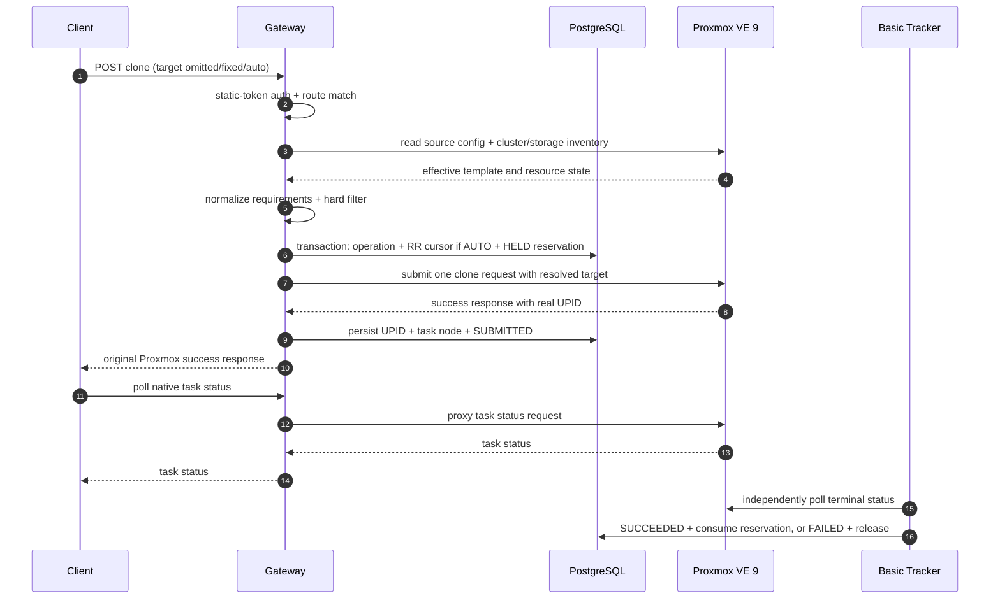

# Vertical Slice 0 — QEMU Clone Placement

> **Trạng thái:** Đặc tả triển khai thử nghiệm đầu tiên. Slice này dùng để xác thực luồng kỹ thuật trên cluster dev, **không production-ready**.
>
> [`README.md`](../README.md) mô tả kiến trúc production đích. Những giới hạn trong tài liệu này chỉ thu hẹp phạm vi thử nghiệm, không loại bỏ tính năng khỏi production roadmap.

## 1. Mục tiêu

Vertical Slice 0 phải chứng minh end-to-end rằng Gateway có thể:

1. Nhận request clone theo method, path và body của Proxmox.
2. Intercept mọi `POST /api2/json/nodes/{source_node}/qemu/{vmid}/clone`, không chỉ request dùng `auto`.
3. Giữ source node trong path và xử lý ba semantics của `target`: thiếu, fixed node và `auto`.
4. Đọc cấu hình template cùng trạng thái node/storage/VM từ Proxmox.
5. Hard-filter CPU, RAM và shared storage.
6. Giữ đúng fixed target hoặc chọn target bằng round-robin khi `target=auto`.
7. Persist internal operation và resource reservation trước khi submit clone.
8. Submit đúng một clone task và trả nguyên success response chứa UPID thật của Proxmox.
9. Cho client polling task bằng UPID qua Gateway.
10. Theo dõi terminal task state ở background để consume hoặc release reservation.

Slice 0 không nhằm chứng minh idempotency, retry, unknown-outcome recovery hay crash takeover.

### Kết quả xác thực ngày 2026-10-15

- PostgreSQL, Gateway và tracker chạy bằng Docker Compose trên máy dev.
- 34 kiểm thử pass trên Windows/Python 3.10 và image Linux/Python 3.12; DB tests chạy với PostgreSQL thật và Proxmox giả lập.
- Kiểm thử 40 request đồng thời xác nhận không nghẽn executor: chỉ ba clone được submit khi fixture có ba slot CPU.
- Live E2E dùng template `9001` ở `pve1`, full clone trên `nas-nfs`; mỗi case trả UPID thật, task `OK`, operation `SUCCEEDED`, reservation `CONSUMED`.

| Request | VMID kiểm thử | Node đích | VM status |
|:--|:--|:--|:--|
| Thiếu `target` | 101 | pve1 | stopped |
| `target=pve2` | 102 | pve2 | stopped |
| `target=auto` | 103 | pve1 | stopped |

Ba VM kiểm thử được giữ lại. Live E2E xác thực ba semantics tuần tự; concurrency đã kiểm chứng bằng PostgreSQL thật/Proxmox giả lập, chưa claim đã load-test nhiều clone đồng thời trên cluster thật. Các acceptance item khác, đặc biệt Gateway authentication, vẫn cần hoàn thiện.

## 2. Quan hệ với kiến trúc production

- README là nguồn định hướng cho capability và kiến trúc dài hạn.
- Tài liệu này là nguồn phạm vi cho lần triển khai đầu tiên.
- Slice 0 chạy clone qua YAML tuần tự tối thiểu: load/validate/compile, resolve expressions, rồi gọi cùng `Action.execute(args, context)` cho mọi step. Generic DAG Engine và runtime publish vẫn nằm ngoài phạm vi.
- DSL dùng `args`, native resource chain `proxmox.native.nodes(${...}).qemu(${...}).clone.post`, và custom class import trong namespace `adhoc`. Không tạo file/class riêng cho từng endpoint Proxmox.
- Tên module và schema tối thiểu trong tài liệu này có thể được refactor khi tổng quát hóa, nhưng endpoint semantics và các invariant đã chốt phải được giữ.
- Production yêu cầu `Idempotency-Key`, retry/reconciliation an toàn, least-privilege credential, multi-replica recovery và stable error contract; Slice 0 chủ đích chưa đáp ứng các yêu cầu đó.

## 3. Môi trường xác thực

| Thành phần | Cấu hình Slice 0 |
|:--|:--|
| Proxmox | Proxmox VE 9 |
| Cluster | Một cluster dev gồm ba node |
| Gateway host | Một VM hoặc LXC trong cluster Proxmox |
| Deployment | Docker Compose |
| Internal state | PostgreSQL |
| Shared storage | `nas-nfs` |
| Template | Nằm trên `nas-nfs` |
| Client authentication | Một static Gateway bearer token |
| Upstream authentication | Một Proxmox root API token, chỉ dùng trong dev |
| Runtime replicas | Một Gateway và một tracker |

`nas-nfs` phải enabled, active, hỗ trợ VM images và accessible từ cả ba node. Tên node là cấu hình môi trường, không được hardcode vào domain logic. Token và database password chỉ được inject qua environment/secret, không commit vào repository.

## 4. Phạm vi

### 4.1. Trong phạm vi

- Catch-all reverse proxy tối thiểu cho các API cần thiết, bao gồm task status/log.
- Một custom endpoint workflow: QEMU clone.
- YAML sequential runtime và execution plan; một Action Contract chung cho native/adhoc.
- Fixed placement và automatic placement.
- Filter node online, CPU, RAM và khả năng truy cập/dung lượng `nas-nfs`.
- CPU overcommit ratio `1.0`.
- Round-robin trên tập node hợp lệ.
- PostgreSQL operation record, reservation và round-robin cursor.
- Một Proxmox UPID cho mỗi clone operation.
- Basic background task tracker.
- Structured log và correlation ID đủ để truy vết request → operation → reservation → UPID.
- Happy-path E2E trực tiếp trên cluster dev.

### 4.2. Ngoài phạm vi

- QEMU create.
- Configure, resize, cloud-init, start hoặc guest readiness sau clone.
- Generic DAG Engine, durable step execution, runtime Workflow Builder/publish và Management API.
- Public Job API cho clone.
- Idempotency enforcement.
- Automatic retry.
- Unknown-outcome reconciliation tự động.
- Gateway/tracker crash recovery hoặc lease takeover.
- Multi-replica và high availability.
- Multi-tenant, quota và RBAC.
- Advanced scheduler/scoring.
- Tự tìm source node theo VMID.
- Tự cấp `newid` khi client không gửi; đây vẫn là capability production dự kiến.
- Production error schema hoàn chỉnh.
- Cam kết chính xác cho linked clone hoặc disk topology ngoài fixture E2E đã chọn.

> ⚠️ **Cảnh báo:** Slice 0 không bảo đảm exactly-once. Client không được retry mù một clone request sau timeout; operation có thể đã được Proxmox nhận nhưng Gateway chưa lưu được UPID.

## 5. API contract

### 5.1. Endpoint

```http
POST /api2/json/nodes/{source_node}/qemu/{vmid}/clone
```

- `{source_node}` luôn là node thật đang sở hữu source VM/template.
- Gateway không hỗ trợ `/nodes/auto/.../clone` trong contract này.
- `{vmid}` là source VM/template ID.
- Body giữ schema Proxmox; Slice 0 yêu cầu client truyền `newid` hợp lệ và chưa được dùng.
- `auto` là sentinel dành riêng của Gateway cho **target**, không phải node name hợp lệ.

### 5.2. Semantics của `target`

| Body | Placement mode | Upstream behavior |
|:--|:--|:--|
| Không có `target` | `FIXED(source_node)` | Không tự chèn field; giữ native behavior tại source node |
| `target=<real_node>` | `FIXED(real_node)` | Forward nguyên target nếu node qua filter |
| `target=auto` | `AUTO` | Chọn node rồi chỉ thay `auto` bằng node thật |

Invariant:

- Literal `auto` không bao giờ được gửi tới Proxmox.
- Fixed node không hợp lệ thì request bị từ chối; không fallback sang node khác.
- Fixed placement không đọc/cập nhật round-robin cursor để ra quyết định.
- Thiếu `target` tuyệt đối không được diễn giải thành auto.
- Source node phải tồn tại và source config phải đọc được trước khi placement.
- Mọi trường request không liên quan routing được bảo toàn.

### 5.3. Success response

Gateway chờ đến khi Proxmox chấp nhận clone và trả UPID, không chờ clone hoàn tất. Gateway chuyển tiếp status, body và content type phù hợp từ Proxmox:

```json
{
  "data": "UPID:pve2:00001234:...:qmclone:101:root@pam:"
}
```

- Đây là UPID thật, không phải synthetic UPID.
- Clone endpoint không trả `202 + job_id`.
- Internal operation ID không thuộc public contract Slice 0.
- HTTP success chỉ có nghĩa task đã được chấp nhận. Clone thành công phải được xác định từ terminal task status.

### 5.4. Polling task

Client tiếp tục dùng native task API qua Gateway, ví dụ:

```http
GET /api2/json/nodes/{task_node}/tasks/{encoded_upid}/status
```

Gateway phải persist `task_node` nhận/suy ra từ UPID hoặc response thực tế; không mặc định task node luôn bằng clone target.

### 5.5. Error handling trong Slice 0

- Public error không có field yêu cầu client phân biệt Gateway error và Proxmox error.
- Internal operation/log vẫn lưu `failure_origin`, upstream status/body đã sanitize và correlation ID.
- Public error shape là provisional; acceptance chính tập trung vào happy path.
- Known failure trước khi nhận UPID phải release reservation.
- Timeout sau submit có thể đưa operation vào `UNKNOWN`; Slice 0 ghi nhận nhưng không tự retry/reconcile.

## 6. Luồng xử lý



Admission/submit diễn ra trong HTTP request để có thể trả UPID thật. Task completion là bất đồng bộ và được tracker theo dõi độc lập với việc client polling.

## 7. Resource discovery và normalization

Gateway cần thu thập:

- node list và online status;
- `maxcpu`, `maxmem` hoặc dữ liệu capacity tương đương của từng node;
- VM inventory cùng configured CPU/RAM;
- effective source template config: CPU, RAM và disk/storage mapping;
- trạng thái/capacity của `nas-nfs` trên target nodes;
- dung lượng còn lại cấp datastore của `nas-nfs`.

Resource request của clone được suy ra từ source template vì Slice 0 không configure lại CPU/RAM sau clone. Disk requirement được ước lượng từ disk config của template. Fixture E2E chuẩn dùng full clone trên `nas-nfs`; linked clone và exotic disk layout chưa được tuyên bố là đã accounting chính xác.

Adapter phải kiểm chứng cách chuẩn hóa `cores`, `sockets`, `vcpus`, memory unit và disk sizes trên PVE 9 trước khi khóa công thức; không hardcode theo giả định chưa probe.

## 8. Hard filter và accounting

### 8.1. CPU

```text
cpu_capacity = node.maxcpu × 1.0
cpu_available = cpu_capacity - committed_vcpu - held_vcpu
eligible when requested_vcpu <= cpu_available
```

### 8.2. RAM

```text
memory_available = node.maxmem - host_reserved_memory
                   - committed_memory - held_memory
eligible when requested_memory <= memory_available
```

Slice 0 đặt `host_reserved_memory = 0` để đơn giản hóa thử nghiệm. Đây không phải production default.

### 8.3. Shared storage

Hai kiểm tra tách biệt:

1. Target eligibility: `nas-nfs` active/enabled/accessible và hỗ trợ VM images trên target.
2. Shared capacity: dung lượng `nas-nfs` chỉ tính một lần cho cluster, không nhân theo ba node.

```text
storage_available = nas_nfs.available - held_storage
eligible when requested_storage <= storage_available
```

### 8.4. Accounting assumptions

- VM không phải template, kể cả stopped VM, được tính là committed CPU/RAM.
- Template không được tính như runtime CPU/RAM allocation.
- Clone đang chờ được tính qua reservation.
- Sau task success, tracker xác nhận VM mới xuất hiện trước khi chuyển hold thành allocation.
- Không double-count cùng VM ở cả inventory allocation và consumed reservation.

## 9. Round-robin

- Eligible nodes được canonical-sort theo node name để thứ tự dễ quan sát và deterministic.
- PostgreSQL lưu `last_selected_node` theo cluster/policy.
- AUTO placement lock cursor bằng transaction, chọn eligible node tiếp theo rồi vòng lại đầu ring.
- Cập nhật cursor, tạo reservation và gắn selected target vào operation trong cùng transaction.
- Nếu eligible set thay đổi, chọn node hợp lệ kế tiếp trong ring hiện tại.
- FIXED request không thay đổi cursor.

Admission đọc inventory và reservation dưới PostgreSQL transaction-level advisory lock theo cluster. Trong mỗi process, asyncio lock giữ các request đang chờ ngoài threadpool; PostgreSQL vẫn là khóa có hiệu lực giữa các process. Khóa được thả sau khi đã ghi operation/reservation/cursor, trước khi submit clone. Vì vậy admission tuần tự nhưng các task clone đã submit được phép chạy đồng thời.

VM đã xuất hiện trong inventory khi reservation còn `HELD` chỉ được tính qua hold, không tính hai lần. Allocation `CONSUMED` chưa xuất hiện trong inventory được dùng làm fallback CPU/RAM. Trong Slice 0, deletion/migration/resize ngoài luồng clone chưa reconcile allocation fallback; đây là phạm vi cần hoàn thiện trước production.

Round-robin không thay thế hard filter. Nó chỉ chọn giữa những node đã qua toàn bộ eligibility checks.

## 10. Persistence tối thiểu

Slice 0 không cần generic `jobs`/`step_runs` queue. Nó cần ba nhóm record đủ cho clone flow và có thể migrate sang production model sau này.

### 10.1. `operations`

Trường dự kiến:

- `id`
- `type = QEMU_CLONE`
- `correlation_id`
- `created_by_subject = dev-client`
- `source_node`
- `source_vmid`
- `target_mode`
- `requested_target`
- `selected_target`
- `newid`
- `status`
- `upid`
- `task_node`
- `failure_origin` — internal only
- `upstream_status`
- sanitized error metadata
- timestamps

State tối thiểu:

```text
RESERVED → SUBMITTING → SUBMITTED → SUCCEEDED | FAILED
               └──────→ UNKNOWN
```

`UNKNOWN` ghi nhận timeout/outcome chưa rõ để operator kiểm tra thủ công; Slice 0 không tự động recovery.

### 10.2. `resource_reservations`

- `id`
- `operation_id`
- `target_node`
- `storage_id`
- `vcpu`
- `memory_bytes`
- `storage_bytes`
- `status = HELD | CONSUMED | RELEASED`
- timestamps

### 10.3. `round_robin_cursors`

- `cluster_key`
- `last_selected_node`
- `updated_at`

## 11. Basic tracker

Tracker poll các operation `SUBMITTED` bằng UPID và task node:

- Terminal `exitstatus=OK`: xác nhận `newid` tồn tại tại selected target, mark `SUCCEEDED`, chuyển reservation khỏi `HELD` mà không double-count inventory.
- Terminal failure: mark `FAILED`, release reservation và giữ error provenance nội bộ.
- Non-terminal: giữ `SUBMITTED` và poll lại theo interval cấu hình.
- Tracker không retry clone, không compensation và không tự giải quyết `UNKNOWN`.
- Tracker chưa có claim lease, heartbeat hoặc multi-replica takeover.

Tracker là process riêng (`python -m app.tracker`), polling bằng task node lấy từ UPID. `TRACKER_CONCURRENCY` giới hạn số tác vụ polling đồng thời; không phải giới hạn số clone Proxmox có thể chạy. Khi task success, tracker còn kiểm tra VM config trên selected target trước khi consume reservation. Poll timeout giữ nguyên `SUBMITTED/HELD`; terminal failure chuyển `FAILED/RELEASED`.

Dữ liệu được persist để mở đường cho recovery ở slice sau, nhưng restart giữa task chưa phải acceptance guarantee của Slice 0.

## 12. Authentication và secrets

- Client gửi một static bearer token của Gateway.
- Static token ánh xạ tới principal duy nhất `dev-client`.
- Website backend và direct API client dùng chung token nên chưa phân biệt end-user identity.
- Gateway strip credential client trước khi gọi upstream.
- Gateway inject Proxmox root API token từ environment/secret.
- Không log token, raw authorization header hoặc database password.
- Direct browser use chỉ dành cho dev; không nhúng shared static token vào frontend production.
- Proxmox TLS verification/CA phải là config rõ ràng; không mặc định tắt verify.

Root token và static shared token là lựa chọn feasibility, không phải security model production.

## 13. Deployment Slice 0

Docker Compose tối thiểu:

- `gateway`: auth, catch-all proxy, clone admission, filter/placement/reservation và upstream submission;
- `tracker`: poll terminal Proxmox task và hoàn tất accounting;
- `postgres`: operations, reservations và round-robin cursor.

Không cần Redis hoặc RabbitMQ.

Triển khai hiện tại có [`compose.yaml`](../compose.yaml), gồm một Gateway, một tracker và PostgreSQL 17 với named volume. Chạy bằng:

```powershell
docker compose --env-file src/app/.env up -d --build
```

Gateway bind `127.0.0.1:8000`; PostgreSQL bind `127.0.0.1:5433`. Gateway static-token authentication vẫn là TODO trong triển khai hiện tại; chưa mở Gateway ra mạng ngoài. Không dùng `down -v` nếu cần giữ operation/reservation.

Local Python sử dụng `DATABASE_DSN` tới localhost; Compose tự override DSN tới service `postgres`. Gateway/tracker tạo initial schema idempotently khi khởi động. Đây chưa phải cơ chế migration có version cho production.

Kiểm thử:

```powershell
$env:PYTHONPATH='src;tests'
$env:RUN_POSTGRES_TESTS='1'
python -m unittest discover -s tests -v
```

DB integration tests dùng Proxmox giả lập và cluster key `tests:<uuid>`, chỉ dọn record thuộc chính test đó.

[`scripts/verify_clone_live.py`](../scripts/verify_clone_live.py) mặc định chỉ đọc. `--submit` tạo ba VM stopped từ template `9001` cho các case omitted/fixed/auto, lấy `newid` bằng `/cluster/nextid`, polling task qua Gateway và kiểm tra trạng thái DB. Script không xóa VM; việc tự cấp VMID ở đây thuộc client kiểm thử, không thay đổi yêu cầu `newid` của clone endpoint.

Configuration tối thiểu:

- Proxmox base URL;
- PVE token ID/secret;
- Gateway static token;
- PostgreSQL DSN;
- cluster key;
- storage ID `nas-nfs`;
- CPU overcommit `1.0`;
- host reserved memory `0`;
- tracker polling interval;
- TLS verification/CA;
- request/upstream timeouts.

## 14. Observability tối thiểu

Một correlation ID phải nối được request → operation → reservation → UPID.

Structured logs tối thiểu ghi:

- source node và source VMID;
- `newid`;
- target mode và requested target;
- candidate rejection reasons;
- selected target;
- operation/reservation state transitions;
- UPID và task node;
- terminal task status;
- internal failure origin khi có.

Không cần Prometheus trong Slice 0, nhưng structured logs và secret redaction là bắt buộc để debug trên cluster thật.

## 15. Kế hoạch triển khai

### Stage 0 — PVE 9 contract probe

- Capture clone request/success/error response thật.
- Xác minh semantics khi thiếu `target`, fixed target và cross-node full clone.
- Xác minh cách lấy task node từ UPID.
- Xác minh inventory endpoints, units và effective template resources.
- Xác minh full clone trên `nas-nfs`.

### Stage 1 — Compose, auth và pass-through

- Khởi tạo Gateway, tracker và PostgreSQL bằng Docker Compose.
- Static bearer authentication và secret injection.
- Catch-all proxy đủ cho inventory và polling UPID.

### Stage 2 — Persistence

- Migration cho operations, reservations và round-robin cursors.
- Repository cùng state transitions tối thiểu.

### Stage 3 — Resource collector và hard filter

- Source template resource estimator.
- Node/VM/storage inventory collector.
- CPU/RAM/shared-storage calculations.
- Unit tests bằng fixture capture từ PVE 9.

### Stage 4 — Placement

- Parse ba target modes.
- Fixed target validation, không fallback.
- Transactional round-robin và reservation.

### Stage 5 — Clone interceptor

- Match chính xác clone route.
- Giữ nguyên request fields.
- Chỉ rewrite `target=auto`.
- Submit clone, persist UPID/task node và trả upstream success response.

### Stage 6 — Tracker

- Poll task status.
- Xử lý terminal success/failure.
- Consume/release reservation.

### Stage 7 — Verification

- Unit tests cho normalization/filter/round-robin.
- Integration tests với PostgreSQL và fake Proxmox adapter.
- Live E2E happy path trên cluster dev.
- Ghi lại khác biệt giữa PVE 9 thực tế và assumptions để cập nhật tài liệu trước slice tiếp theo.

## 16. Acceptance criteria

- Chỉ request có đúng static Gateway token mới được xử lý.
- Clone thiếu `target` giữ native source-node behavior.
- Clone fixed target chạy đúng node yêu cầu nếu eligible.
- Fixed target không fallback và không thay đổi round-robin cursor.
- `target=auto` không bao giờ đến Proxmox dưới dạng literal `auto`.
- AUTO requests liên tiếp đi vòng qua eligible nodes theo thứ tự xác định.
- Node offline, thiếu CPU/RAM hoặc không truy cập/không đủ `nas-nfs` không thuộc eligible set.
- CPU accounting dùng overcommit `1.0`.
- Shared NFS capacity không bị nhân theo số node.
- Reservation tồn tại trước khi upstream clone được submit.
- Operation lưu source, selected target, `newid`, UPID và task node.
- Missing/fixed/auto target trả cùng success response contract.
- Response success chứa UPID thật của Proxmox, không phải `job_id`.
- Client polling UPID qua Gateway đến terminal state được.
- Tracker đánh dấu success và không để reservation `HELD` tồn dư trong happy path.
- Known task failure release reservation.
- Non-clone endpoints cần cho inventory và task polling được pass-through.
- Fake-adapter tests chứng minh filter/placement; live E2E chứng minh clone happy path.

## 17. Giả định và giới hạn đã biết

### 17.1. Giả định của ca kiểm thử

1. Client truyền đúng source node; Gateway chưa tự tìm template theo VMID.
2. Client truyền `newid` hợp lệ, chưa tồn tại.
3. Source template hợp lệ, không locked và source node online.
4. Template disks đều nằm trên `nas-nfs`.
5. Ca E2E chuẩn là full clone.
6. `nas-nfs` active trên mọi target và hỗ trợ VM images.
7. Cluster có quorum và network ổn định trong lúc thử nghiệm.
8. Không có admin/process ngoài luồng tạo hoặc migrate VM đồng thời trong ca E2E chính.
9. Mọi request thử nghiệm đi qua Gateway.
10. Stopped non-template VM vẫn được tính committed; template không được tính runtime CPU/RAM allocation.
11. `host_reserved_memory=0` và CPU overcommit `1.0` chỉ là policy dev.
12. `auto` là reserved sentinel, không phải node name thật.
13. Chỉ có một Gateway và một tracker replica.

### 17.2. Giới hạn và cảnh báo

- Không retry request sau timeout.
- Không bảo đảm exactly-once.
- Gateway/tracker crash giữa operation có thể cần can thiệp thủ công.
- Timeout sau submit là unknown outcome; không tự POST lại.
- Resource snapshot có thể stale.
- Mutation trực tiếp, HA hoặc admin action có thể gây accounting drift.
- Storage estimator mới được xác thực với full-clone fixture trên `nas-nfs`.
- Linked clone chưa được cam kết accounting chính xác.
- Static Gateway token và Proxmox root token không phù hợp production.
- Public error schema chưa ổn định.
- Một replica, không HA.

Các giới hạn này phải được xử lý ở những giai đoạn production tiếp theo trong README; chúng không phải quyết định loại bỏ capability.
